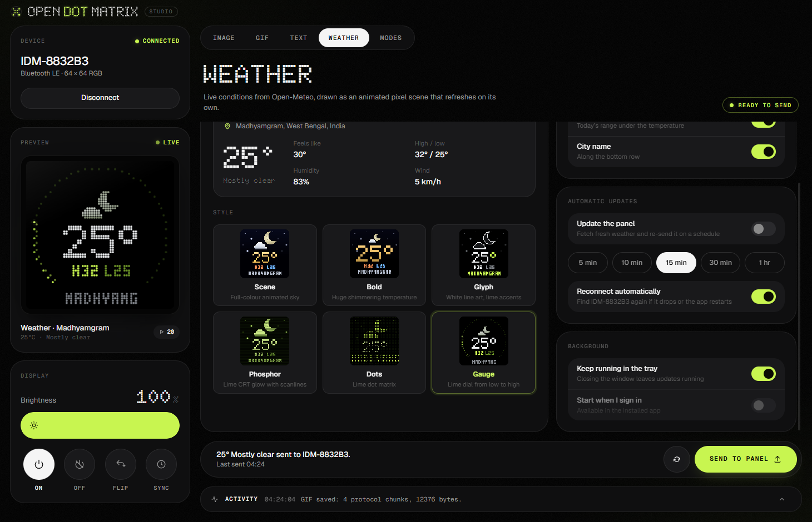
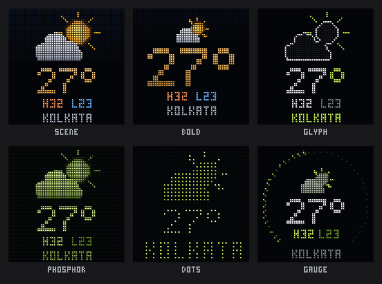

# Open Dot Matrix

Open Dot Matrix is an open-source desktop studio for **iDotMatrix 64 × 64 RGB LED panels**. Create images, animations, text, and weather scenes, then send them to a panel over Bluetooth Low Energy (BLE). The app also controls the panel’s built-in modes and display settings.



*The Weather workspace, connected to an iDotMatrix panel.*

**Current version:** [v0.1.0](https://github.com/essjaykay755/open-dot-matrix/releases/tag/v0.1.0) · [All releases](https://github.com/essjaykay755/open-dot-matrix/releases)

## Supported displays

The app targets **64 × 64 RGB iDotMatrix panels** that use the compatible iDotMatrix BLE protocol. Content rendering and frame transfers are sized for a square 64 × 64 display. Other resolutions, panel layouts, models, or firmware versions are not guaranteed to work.

The Bluetooth picker can show devices that the app cannot control. A device must expose the expected iDotMatrix BLE write and notification characteristics; appearing in the picker alone does not confirm compatibility. Use **Demo** to explore the studio without a physical panel.

## Features

| Tool | Capabilities |
| --- | --- |
| **Image** | Fit, fill, or stretch an image to 64 × 64; choose a background, rotate the output 180°, use pixelated scaling, or send a calibration pattern. |
| **GIF** | Resize and re-encode animated GIFs with the same framing controls. Files up to 50 MB are accepted; transfers are limited to 64 frames. |
| **Text** | Render text locally and send it with one of nine motion modes, adjustable speed, solid or rainbow color, and a configurable background. |
| **Weather** | Create an animated weather scene using current conditions. Choose Scene, Bold, Glyph, Phosphor, Dots, or Gauge styling; set °C or °F; and optionally show the city and daily high/low. |
| **Built-in modes** | Set a solid color, choose from eight clock faces, start a countdown or stopwatch, update a scoreboard, or set the screen timeout and time indicator. |
| **Display controls** | Adjust brightness, turn the panel on or off, flip the display, or sync its clock. |

Weather location search and forecasts use [Open-Meteo](https://open-meteo.com/) and require an internet connection, but no API key. Weather can be sent on demand or refreshed every 5, 10, 15, 30, or 60 minutes. Automatic updates can reconnect to the last selected panel and continue while the app is kept in the system tray.

### Weather styles



More animations are available in [`docs/weather-previews`](docs/weather-previews).

## Requirements

- A current Node.js LTS release with npm to run or build from source.
- For panel control, a Bluetooth LE adapter, an enabled and nearby compatible 64 × 64 iDotMatrix panel, and an operating system that grants the app Bluetooth access.
- An internet connection for weather location search and updates.

## Run from source

Clone the repository, install the locked dependencies, and start the desktop app:

```sh
git clone https://github.com/essjaykay755/open-dot-matrix.git
cd open-dot-matrix/app
npm ci
npm run dev
```

Choose **Demo** to try the tools without hardware. To use a panel, choose **Connect panel** and select it in the Bluetooth device picker. Prepare content in the **Image**, **GIF**, **Text**, **Weather**, or **Modes** tab, review the preview, and send it to the panel.

## Weather scheduling and tray behavior

In the Weather tab, enable **Update the panel** and choose an interval to refresh the forecast and send it automatically. Enable **Reconnect automatically** to let the app find the last selected panel again if the Bluetooth connection drops.

With **Keep running in the tray** enabled, closing the window hides the app so scheduled weather updates can continue. Reopen it or send an update from the tray menu; choose **Quit** in the tray menu to stop the app. Launch at sign-in is available in installed Windows and macOS builds.

## Troubleshooting

### The panel does not appear in the Bluetooth picker

Turn on the panel and Bluetooth, keep the panel nearby, and check that the operating system allows the app to use Bluetooth. The picker may include unrelated devices; only compatible iDotMatrix panels are supported.

### The panel connects but does not show the content

Connection alone does not confirm protocol compatibility. This app sends 64 × 64 frames using the iDotMatrix BLE protocol. Check that the panel is a compatible model, disconnect and reconnect, then try a small image or the calibration pattern.

### Weather location search or updates fail

Weather features need an internet connection to reach Open-Meteo. Check the connection and try searching for the location again. Weather scheduling also requires **Update the panel** to be enabled; scheduled sends stop when the app is quit.

## Build and package

Run these commands from `app/`:

| Command | Result |
| --- | --- |
| `npm run typecheck` | Type-check the Electron and renderer TypeScript projects. |
| `npm test` | Run the Vitest unit tests. |
| `npm run build` | Type-check and create the production app bundle. |
| `npm run package` | Build an unpacked desktop app. |
| `npm run dist:win` | Build a Windows NSIS installer. |
| `npm run dist:mac` | Build a macOS DMG. |
| `npm run dist:linux` | Build a Linux AppImage. |

Packaging targets are defined in [`app/electron-builder.yml`](app/electron-builder.yml). Distribution commands write their output to `app/release/`.

## Project structure

- `app/src/main/` — Electron window, Bluetooth device selection, and tray behavior.
- `app/src/preload/` — limited bridge between the Electron main process and the UI.
- `app/src/renderer/` — React interface, panel tools, content rendering, weather scenes, and BLE client.
- `app/src/shared/` — types shared by the Electron main and renderer processes.
- `docs/weather-previews/` — app screenshot and exported weather-style animations.

The desktop shell is Electron. The interface is React and TypeScript, built with Vite through `electron-vite`. Image and text processing happens locally; weather data is fetched from Open-Meteo.
